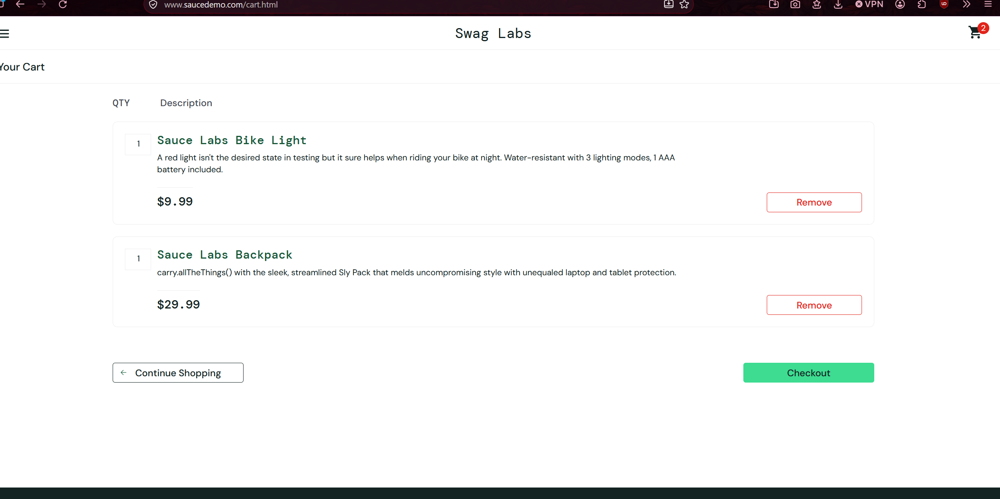
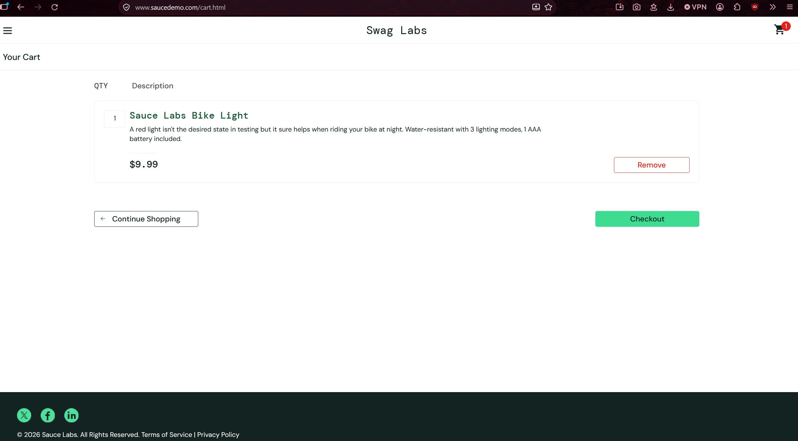

# Self-Designed Testing — Member D

## Testing Idea

Investigate whether the SauceDemo shopping cart updates correctly when multiple products are added and one product is removed.

## Reason

I want to check whether the shopping cart displays the correct number of products and whether the correct products remain in the cart after removing an item.

This is useful because users should be able to add and remove products without the cart displaying incorrect information.

## Test Basis

The investigation is based on the expected shopping cart behaviour.

The practical does not provide a specific acceptance criterion for this additional scenario. Therefore, the expected behaviour is treated as an assumption based on the visible shopping cart functionality.

## Approach

1. Log in using the standard demonstration account.
2. Add two different products to the shopping cart.
3. Observe the shopping cart badge.
4. Open the shopping cart and check the products displayed.
5. Remove one product.
6. Check whether the cart badge and product list update correctly.

## Test Cases

### Test ID: OWN-D-01

| Item | Details |
|---|---|
| Test type | Exploratory / Positive |
| Tester | member-d |
| Website | [SauceDemo](https://www.saucedemo.com/) |
| Status | Pass |

#### Purpose

To investigate whether the shopping cart correctly displays multiple added products and updates when one product is removed.

#### Preconditions

- The SauceDemo login page is open.
- The user is logged out.
- The standard demonstration account is available.
- The shopping cart is empty.

#### Test Data

| Field | Value |
|---|---|
| Username | `standard_user` |
| Password | `secret_sauce` |
| First product | Sauce Labs Backpack |
| Second product | Sauce Labs Bike Light |

#### Steps

1. Open the SauceDemo website.
2. Enter the username `standard_user`.
3. Enter the password `secret_sauce`.
4. Select Login.
5. Confirm that the inventory page is displayed.
6. Check that the shopping cart is initially empty.
7. Add Sauce Labs Backpack to the cart.
8. Add Sauce Labs Bike Light to the cart.
9. Observe the shopping cart badge.
10. Open the shopping cart.
11. Check whether both products are displayed.
12. Remove Sauce Labs Backpack.
13. Observe the shopping cart badge again.
14. Check whether only Sauce Labs Bike Light remains in the cart.
15. Confirm that Sauce Labs Backpack is no longer displayed.

#### Expected Result

Based on the assumed shopping cart behaviour:

- Both products should appear in the cart after being added.
- The shopping cart badge should display `2`.
- After removing Sauce Labs Backpack, only Sauce Labs Bike Light should remain.
- The shopping cart badge should update to `1`.

#### Actual Result

- Both Sauce Labs Backpack and Sauce Labs Bike Light were added to the shopping cart.
- The shopping cart badge displayed `2`.
- Both products were displayed in the shopping cart.
- After removing Sauce Labs Backpack, only Sauce Labs Bike Light remained.
- The shopping cart badge updated to `1`.
- Sauce Labs Backpack was no longer displayed in the cart.

#### Evidence

**Screenshot 1 — Both products added**
c

**Screenshot 2 — Cart after removing one product**

---

## Overall Observations

The shopping cart behaved as expected during the investigation.

After adding two products, the shopping cart badge displayed 2 and both products appeared in the cart. After removing Sauce Labs Backpack, the badge updated to 1 and only Sauce Labs Bike Light remained.

No unexpected behaviour was observed during this test.

## Next Question

Does the shopping cart retain its products when the user navigates back to the inventory page and then returns to the cart?

This could be investigated in a follow-up test.

## 12.6 Step 6 — Summarise What You Learned

- **What I investigated:** Whether the shopping cart updates correctly when products are added and removed.
- **What I learned:** The shopping cart badge and product list updated correctly during the test.
- **Uncertainty:** Only adding two products and removing one product were investigated. Other shopping cart behaviours have not been tested.
- **What I would test next:** Navigate back to the inventory page and return to the shopping cart to check whether the remaining product is retained.
