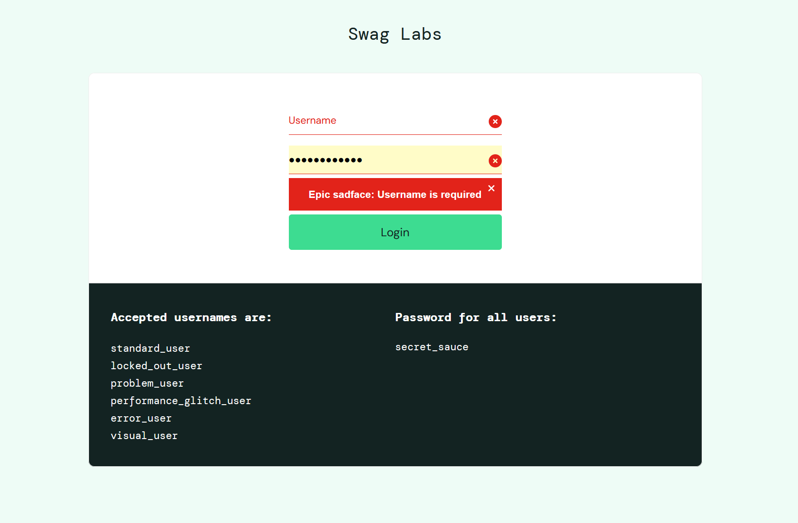
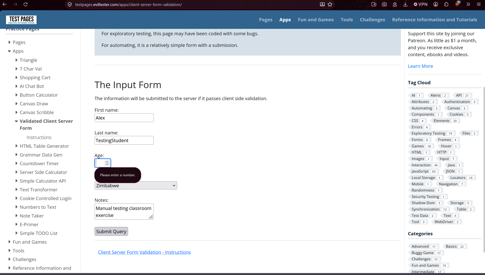

# Manual Testing Results — Member D

## Environment

| Item | Details |
|---|---|
| Tester identifier | member-d |
| Date and time | 3 November 2026, 2:58 pm |
| Browser and version | Firefox, 159.0 (64-bit) |
| Operating system | Windows |

## Login Tests
### Test ID: LOGIN-N03

| Item | Details |
|---|---|
| Test type | Negative |
| Tester | member-d |
| Website | [SauceDemo](https://www.saucedemo.com/) |
| Status | Pass |

#### Purpose

Check whether the application rejects a login attempt with a missing username.

#### Preconditions

The SauceDemo login page is open.

#### Test Data

| Field | Value |
|---|---|
| Username: Empty | Password: secret_sauce |

#### Steps

1. Open SauceDemo.
2. Leave the username empty.
3. Enter the password.
4. Select Login.
5. Observe the feedback.

#### Expected Result

The attempt is rejected with validation feedback. The inventory is not reached.

#### Actual Result

Login is rejected with validation feedback, "Epic sadface: Username is required". The inventory is not reached.

#### Evidence

---

## Equivalence Partitioning
### Test ID: AGE-EP-BLANK-D

| Item | Details |
|---|---|
| Test type | Negative / Input-format observation |
| Tester | Member D |
| Website | [Test Pages Validation Form](https://testpages.eviltester.com/apps/client-server-form-validation/) |
| Status | Pass |

#### Purpose

To observe how the form handles an empty age field when all other fields contain valid data.

#### Preconditions

- The validation form is open.
- The baseline data has been confirmed to work.
- All other fields contain valid baseline data.

#### Test Data

| Field | Value |
|---|---|
| First name | Alex |
| Surname | TestingStudent |
| Age | (Blank) |
| Country | Zimbabwe |
| Notes | Manual testing classroom exercise |

#### Steps

1. Open the Test Pages form.
2. Enter a valid first name.
3. Enter a valid surname.
4. Leave the age field empty.
5. Select a valid country.
6. Enter valid notes.
7. Click the Submit button.
8. Observe the validation feedback.

#### Expected Result

The form should reject the blank age input and display an appropriate validation message. The form should not accept the submission with a missing age.

#### Actual Result

The form displayed the validation message “Please enter a number” when the age field was left blank.

#### Evidence

---

### Test ID: AGE-EP-ABC-D

| Item | Details |
|---|---|
| Test type | Negative |
| Tester | Member D |
| Website | [Test Pages Validation Form](https://testpages.eviltester.com/apps/client-server-form-validation/) |
| Status | Pass |

#### Purpose

To check whether the form rejects non-numeric characters entered into the age field.

#### Preconditions

- The Test Pages form is open.
- All other required fields contain valid information.

#### Test Data

| Field | Value |
|---|---|
| First name | Alex |
| Surname | TestingStudent |
| Age | abc |
| Country | Zimbabwe |
| Notes | Manual testing classroom exercise |

#### Steps

1. Open the Test Pages form.
2. Enter a valid first name.
3. Enter a valid surname.
4. Enter abc into the age field.
5. Select a valid country.
6. Enter valid notes.
7. Click the Submit button.
8. Observe the validation feedback.

#### Expected Result

The form should reject non-numeric age input and display an appropriate validation message. The form should not accept the submission with letters entered as the age.

#### Actual Result

The form displayed the validation message “Please enter a number” when abc was entered into the age field.

#### Evidence

---

## 2-Point Boundary Tests
### Test ID: YOUR-TEST-ID

| Item | Details |
|---|---|
| Test type | Positive / Negative / Recovery |
| Tester | Your member identifier |
| Website | Website name |
| Status | Not run |

#### Purpose

What does this test check?

#### Preconditions

What must be true before the test starts?

#### Test Data

| Field | Value |
|---|---|
| Input name | Input value |

#### Steps

1.
2.
3.

#### Expected Result

Write this before executing the test.

#### Actual Result

Not recorded — test has not been executed.

#### Evidence

Not captured.

---

## 3-Point Boundary Tests
### Test ID: YOUR-TEST-ID

| Item | Details |
|---|---|
| Test type | Positive / Negative / Recovery |
| Tester | Your member identifier |
| Website | Website name |
| Status | Not run |

#### Purpose

What does this test check?

#### Preconditions

What must be true before the test starts?

#### Test Data

| Field | Value |
|---|---|
| Input name | Input value |

#### Steps

1.
2.
3.

#### Expected Result

Write this before executing the test.

#### Actual Result

Not recorded — test has not been executed.

#### Evidence

Not captured.

---